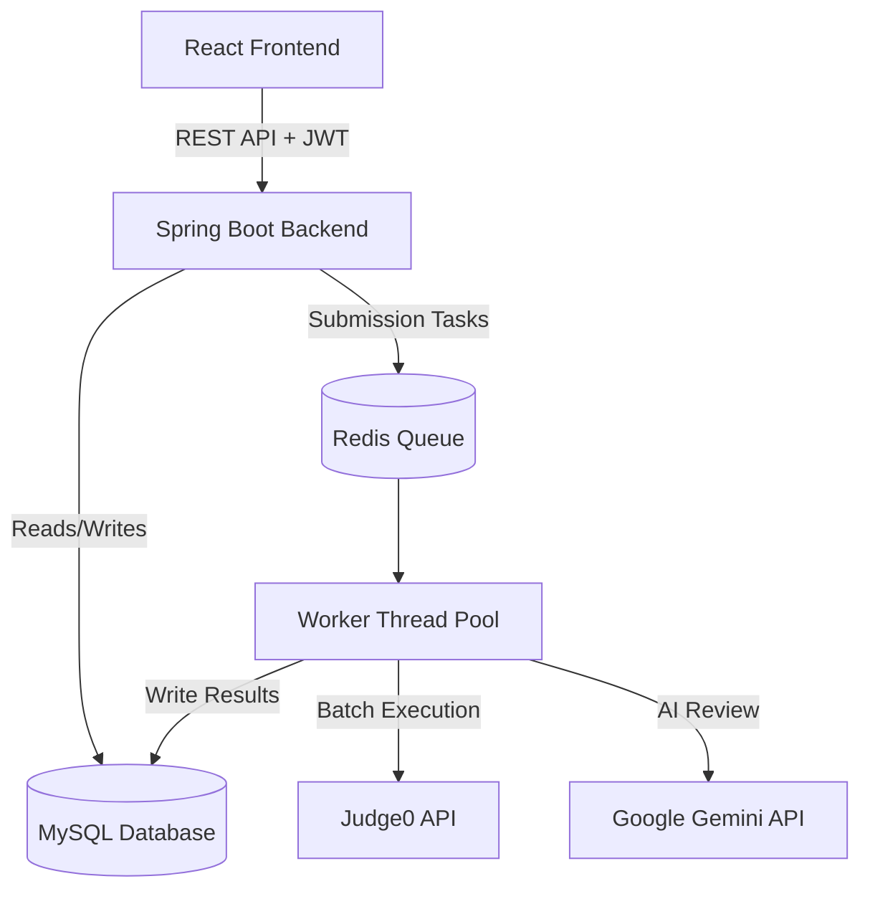

# CodeArena 🚀

CodeArena is a modern, high-performance competitive programming and DSA practice platform built with Spring Boot, React, and MySQL. It features a scalable, multi-language code execution engine, real-time submission polling via Redis queues, AI-powered code analysis, and a LeetCode-style interactive UI.


## 🌟 Key Features

- **Multi-Language Code Execution**: Safely compile and execute user code in Java, Python, C++, and JavaScript against hidden test cases.
- **Async Submission Queueing**: Uses a Redis-backed Worker Thread Pool to batch and process submissions concurrently without blocking the main API threads.
- **AI-Powered Code Analysis**: Integrated with Google Gemini API to analyze submitted code, extract Big-O Time & Space complexity, and provide constructive optimization hints.
- **Robust Authentication**: Secure JWT-based authentication, Role-Based Access Control (RBAC), and OTP-based email verification.
- **Comprehensive Profile System**: Tracks total submissions, calculates real-time acceptance rates, visualizes problem difficulty breakdown, and allows customizable avatars/bios.
- **100% Tested Services**: Core business logic (Auth, Profiles, Submissions) is fully validated with JUnit 5 and Mockito, ensuring production-grade reliability.

## 🏗️ Architecture



## 🛠️ Technology Stack

**Frontend:**
- React 18, React Router DOM
- CodeMirror (Code Editor)
- Recharts (Profile Analytics)
- Vanilla CSS (Glassmorphism & Flex/Grid)

**Backend:**
- Java 17, Spring Boot 3
- Spring Security (JWT Auth)
- Hibernate / Spring Data JPA
- JUnit 5 & Mockito

**Infrastructure / External APIs:**
- MySQL (Persistence)
- Redis (Session Caching & Task Queues)
- Judge0 API (Sandboxed Code Execution)
- Google Gemini API (AI Code Analysis)
- EmailJS (OTP Delivery)

## 🚀 Getting Started

### Prerequisites
- JDK 17
- Node.js & npm
- MySQL server
- Redis server running on port 6379

### Local Setup

1. **Clone the repository**
   ```bash
   git clone https://github.com/RamSharma404/CodeArena.git
   cd CodeArena
   ```

2. **Configure Environment Variables**
   Create a `.env` file in the root directory (or inject directly into your IDE):
   ```env
   DB_URL=jdbc:mysql://localhost:3306/codearena
   DB_USER=root
   DB_PASSWORD=yourpassword
   JWT_SECRET=your_super_secret_key_that_needs_to_be_long_enough
   REDIS_HOST=localhost
   REDIS_PORT=6379
   GEMINI_API_KEY=your_gemini_key
   ```

3. **Start the Backend (Spring Boot)**
   ```bash
   cd backend
   mvn spring-boot:run
   ```

4. **Start the Frontend (React)**
   ```bash
   cd frontend
   npm install
   npm start
   ```

### Running Tests
The backend core services are covered by comprehensive JUnit tests. To run them locally:
```bash
cd backend
mvn test
```

## 📝 License
This project is open-source and available under the MIT License.
